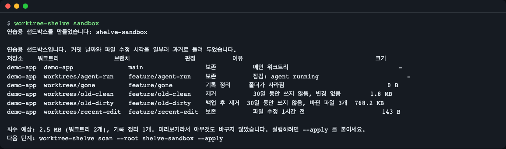
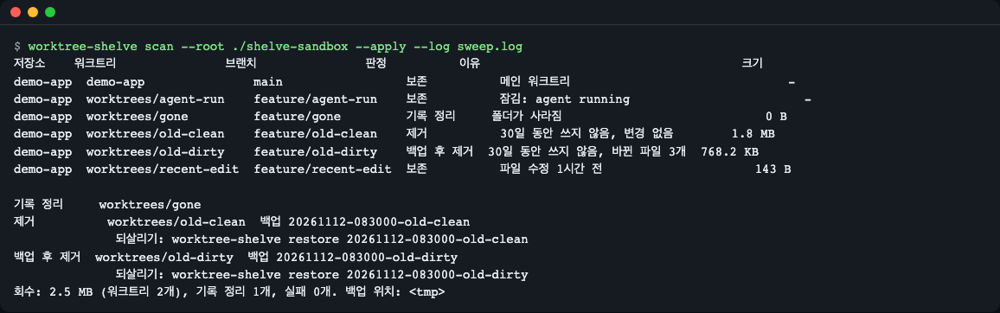
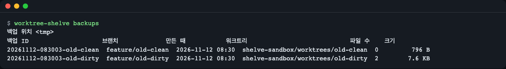
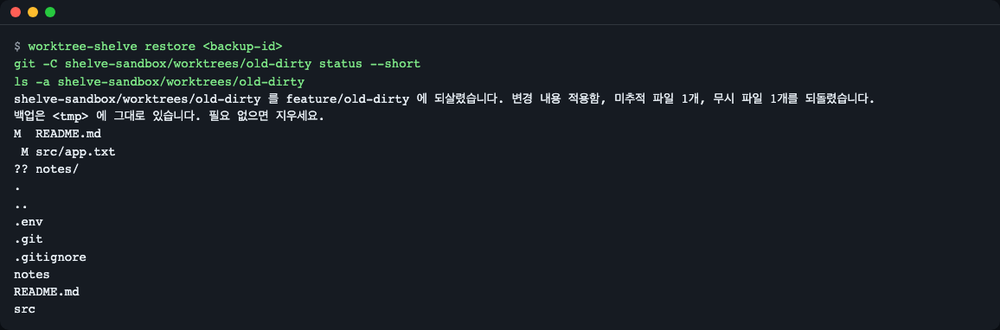
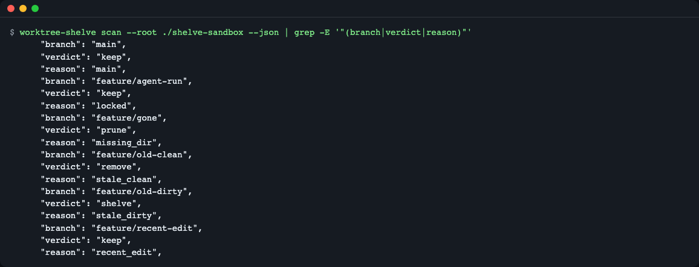
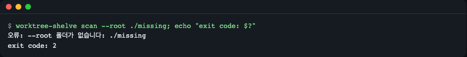
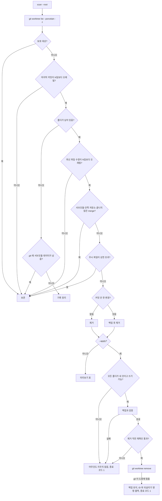

# worktree-shelve

[English](README.md) | **한국어**

오래된 git 워크트리를 찾아, `git worktree remove` 가 조용히 지워 버리는 것까지 백업하고, 백업을 검증한 뒤 워크트리를 제거하고, 나중에 명령 하나로 되살립니다. `--apply` 를 붙이기 전에는 아무것도 지우지 않습니다.


*`worktree-shelve sandbox` 는 연습용 저장소를 만들고 미리보기를 보여 줍니다. 회수할 수 있는 워크트리 2개, 정리할 기록 1개, 보존 3개입니다.*

## 이런 분께

- 코딩 에이전트를 여러 개 돌리거나 워크트리를 손으로 만들다 보니, 잊어버린 체크아웃이 디스크를 채우는 분.
- 커밋 날짜만이 아니라 마지막 커밋과 최신 파일 수정을 함께 보고 정리하고 싶은 분.
- 자동 정리가 커밋하지 않은 작업이나 무시된 `.env` 파일을 지우는 일을 겪고 싶지 않은 분.

## 왜 필요한가

git 워크트리는 같은 저장소를 다른 폴더에 하나 더(셋, 넷…) 체크아웃한 것입니다. 워크트리마다 코드 전체에 `node_modules` 같은 빌드 폴더까지 들어갈 수 있어서, 잊힌 워크트리 열몇 개가 수 GB 를 차지하기도 합니다.

여러 사람이 하다 만 일을 올려 둔 책상을 떠올려 보세요. 일주일 넘은 건 전부 버리면 빠르지만, 누군가는 정리하지 않은 메모를 잃습니다. worktree-shelve 는 꼼꼼한 사무실 관리자처럼 움직입니다. 최근에 손댄 흔적이 없는 책상만 치우고, 흩어진 종이를 먼저 이름 붙인 상자에 담고, 상자를 확인한 뒤, 원하면 책상을 그대로 되돌려 놓습니다.

이 도구가 필요한 이유는 두 가지 사실 때문입니다.

- `git worktree remove` 는 커밋하지 않은 변경이 있으면 거부하지만, `--force` 를 주면 그 변경을 지웁니다.
- `--force` 가 없어도 `.env` 같은 무시된 파일은 경고 없이 지웁니다. git 이 그 파일을 변경으로 보지 않기 때문입니다.

## 설치

전제: [Dart SDK](https://dart.dev/get-dart) 3.8 이상(macOS 는 `brew install dart-sdk`, 리눅스는 Dart 안내 페이지 참고)과 git 2.36 이상. 최소 리눅스 이미지에서는 Dart 설치기에 쓰이는 `tar`, `curl`/`unzip` 도 필요합니다. macOS 와 리눅스를 지원하고 Windows 는 지원하지 않습니다([제한 사항](#제한-사항) 참고).

```bash
# GitHub 에서 (레포가 공개된 뒤 사용 가능)
dart pub global activate --source git https://github.com/LeeGyeongPil/worktree-shelve

# clone 해서
git clone https://github.com/LeeGyeongPil/worktree-shelve
cd worktree-shelve
dart pub get
dart run worktree_shelve sandbox

# 선택: 단일 실행 파일 하나 만들기 (약 6 MB)
dart compile exe bin/worktree_shelve.dart -o worktree-shelve
./worktree-shelve --version
```

```text
worktree-shelve 0.1.0
```

`dart pub global activate` 는 `worktree-shelve` 명령을 `$HOME/.pub-cache/bin` 에 둡니다. 셸이 못 찾으면 그 폴더를 `PATH` 에 추가하세요. 아래 명령은 `worktree-shelve` 가 `PATH` 에 있다고 가정합니다(clone 상태에서는 `dart run worktree_shelve` 로 바꿔 쓰세요).

## 빠르게 시작하기

먼저 연습용 샌드박스로 해 보세요. 실제 git 저장소에 추가 워크트리 5개가 있고, 커밋 날짜와 파일 수정 시각을 일부러 과거로 돌려 두어서 기다릴 필요가 없습니다. 목(mock) 모드는 없습니다. 아래 명령은 전부 샌드박스에서 실제 git 을 실행합니다.

```bash
worktree-shelve sandbox --lang ko
```

```text
연습용 샌드박스를 만들었습니다: shelve-sandbox

연습용 샌드박스입니다. 커밋 날짜와 파일 수정 시각을 일부러 과거로 돌려 두었습니다.
저장소    워크트리               브랜치               판정          이유                                    크기
demo-app  demo-app               main                 보존          메인 워크트리                              -
demo-app  worktrees/agent-run    feature/agent-run    보존          잠김: agent running                        -
demo-app  worktrees/gone         feature/gone         기록 정리     폴더가 사라짐                            0 B
demo-app  worktrees/old-clean    feature/old-clean    제거          30일 동안 쓰지 않음, 변경 없음        1.8 MB
demo-app  worktrees/old-dirty    feature/old-dirty    백업 후 제거  30일 동안 쓰지 않음, 바뀐 파일 3개  768.2 KB
demo-app  worktrees/recent-edit  feature/recent-edit  보존          파일 수정 1시간 전                     143 B

회수 예상: 2.5 MB (워크트리 2개), 기록 정리 1개. 미리보기라서 아무것도 바꾸지 않았습니다. 실행하려면 --apply 를 붙이세요.
다음 단계: worktree-shelve scan --root shelve-sandbox --apply
```

표 읽는 법:

| 판정 | 뜻 |
|---|---|
| `보존` | 건드리지 않습니다. 이유 열에 왜인지 나옵니다: 메인 워크트리, 잠김, 최근 커밋, 최근 파일 수정 등. |
| `제거` | 오래됐고 깨끗합니다. (무시된 설정 파일만) 백업한 뒤 제거합니다. |
| `백업 후 제거` | 오래됐고 커밋하지 않은 변경이 있습니다. 전부 백업한 뒤 제거합니다. |
| `기록 정리` | 폴더는 이미 없고, git 에 남은 기록만 정리합니다. |

`old-dirty` 는 커밋 날짜도 파일 날짜도 오래돼서 `백업 후 제거` 입니다. `recent-edit` 는 커밋은 오래됐지만 한 시간 전에 수정한 파일이 있어 보존됩니다. `agent-run` 은 잠겨 있어서 절대 건드리지 않습니다.

## 사용법

| 명령 | 하는 일 |
|---|---|
| `worktree-shelve scan --root 폴더` | 미리보기. `폴더`(기본: 현재 폴더) 아래 저장소를 찾아 워크트리마다 판정 하나를 출력합니다. 아무것도 바꾸지 않습니다. |
| `worktree-shelve scan --root 폴더 --apply` | `제거`·`백업 후 제거` 워크트리를 백업·검증한 뒤 제거하고, 폴더가 없어진 기록을 정리합니다. |
| `--days N` | 마지막 커밋과 최신 파일 수정이 둘 다 `N`일보다 오래되면 오래된 것으로 봅니다(기본 7). |
| `--ignored-cap MB` | 무시된 비산출물 파일 합계가 `MB` 를 넘는 워크트리는 보존합니다(기본 100). |
| `--backup-dir 폴더` | 백업 위치([설정](#설정) 참고). |
| `--json`, `--log 파일` | 기계가 읽는 출력, 동작마다 JSON 한 줄을 `파일` 끝에 덧붙임. 줄마다 `action`, `result`, `reason`(코드), `reason_text` 가 있습니다. 백업이 다 담지 못해 보존한 오래된 워크트리는 `"action":"skip"` 줄을 남기므로, 예약 실행에서 왜 지우지 않았는지 알 수 있습니다. |
| `worktree-shelve backups` | 백업 목록(`--json` 도 됩니다). |
| `worktree-shelve restore <백업-ID> [--to 경로]` | 제거한 워크트리를 백업에서 다시 만듭니다. |
| `worktree-shelve sandbox [폴더]` | 연습용 저장소를 만들고 미리보기를 보여 줍니다. |

아래 글 예시는 `--backup-dir bk` 로 백업을 현재 위치의 `bk` 폴더에 두어, `scan`·`backups`·`restore` 가 같은 폴더를 쓰게 합니다. 스크린샷은 기본 백업 폴더를 써서 명령에 `--backup-dir` 가 없습니다.

### 실제로 정리하기

```bash
worktree-shelve scan --root ./shelve-sandbox --apply --backup-dir bk --log sweep.log --lang ko
```


*제거한 워크트리마다 백업 ID 와 바로 붙여 넣을 수 있는 되살리기 명령이 나옵니다. `sweep.log` 에는 동작마다 JSON 한 줄이 쌓입니다.*

```text
기록 정리     worktrees/gone
제거          worktrees/old-clean  백업 20261112-073500-old-clean
              되살리기: worktree-shelve restore 20261112-073500-old-clean --backup-dir /path/to/bk
백업 후 제거  worktrees/old-dirty  백업 20261112-073500-old-dirty
              되살리기: worktree-shelve restore 20261112-073500-old-dirty --backup-dir /path/to/bk
회수: 2.5 MB (워크트리 2개), 기록 정리 1개, 실패 0개. 백업 위치: /path/to/bk
```

(표가 먼저 출력되는 것은 미리보기와 같습니다. 경로는 `/path/to/bk` 로 줄였고, 실제로는 전체 경로가 나옵니다. 되살리기 명령에 `--backup-dir` 는 직접 줬을 때만 붙습니다.) 브랜치와 커밋은 저장소에 그대로 남고, 작업 폴더만 제거됩니다.

### 목록 보기와 되살리기

```bash
worktree-shelve backups --backup-dir bk --lang ko
```


*백업은 열어 볼 수 있는 평범한 폴더입니다.*

```text
백업 위치 /path/to/bk:
백업 ID                    브랜치             만든 때           워크트리                            파일 수    크기
20261112-073500-old-clean  feature/old-clean  2026-11-12 07:35  shelve-sandbox/worktrees/old-clean  0         679 B
20261112-073500-old-dirty  feature/old-dirty  2026-11-12 07:35  shelve-sandbox/worktrees/old-dirty  2        7.5 KB
```

```bash
worktree-shelve restore 20261112-073500-old-dirty --backup-dir bk --lang ko
git -C shelve-sandbox/worktrees/old-dirty status --short
```


*되살린 뒤 `git status` 는 제거 전과 같고, 무시된 `.env` 도 돌아옵니다.*

```text
shelve-sandbox/worktrees/old-dirty 를 feature/old-dirty 에 되살렸습니다. 변경 내용 적용함, 미추적 파일 1개, 무시 파일 1개를 되돌렸습니다.
백업은 /path/to/bk/20261112-073500-old-dirty 에 그대로 있습니다. 필요 없으면 지우세요.
M  README.md
 M src/app.txt
?? notes/
```

스테이지한 변경(`M `)과 하지 않은 변경(` M`)이 그대로 돌아옵니다. `node_modules` 같은 산출물은 백업하지 않으므로 되살린 뒤 다시 설치하세요.

### 자동화

```bash
worktree-shelve scan --root ~/code --days 14 --apply --json --log ~/worktree-shelve.log
```


*`verdict` 와 `reason` 은 어느 언어에서나 고정된 영어 코드이고, `reason_text` 는 고른 언어를 따릅니다.*

cron 이나 스케줄러에서 실행하세요. `--root` 아래 저장소가 많으면 git 호출이 늘어 시간이 걸릴 수 있으니, `--root` 를 좁은 폴더로 지정하면 빨라집니다. 종료 코드: `0` 정상, `1` 일부 워크트리 실패, `2` 사용법·환경 오류. 실패한 워크트리는 손대지 않고 그대로 둡니다. 단, 지우는 도중 git 자체가 멈춘 경우에는 오류 메시지에 백업 ID 와 되살리기 명령을 알려 줍니다([자주 겪는 문제](#자주-겪는-문제) 참고). 오류는 한 줄입니다.


*오류는 스택 트레이스 없이 stderr 한 줄로 나옵니다.*

## 안전 장치

- **기본은 미리보기.** `--apply` 가 없으면 git 에는 읽기 전용 질문만 합니다. 테스트가 전후의 워크트리 목록과 폴더 목록이 같은지 확인합니다.
- **최근 흔적이 하나라도 있으면 보존.** 최근 커밋, 최근 파일 수정(미래 날짜도 최근으로 봅니다), 잠금, 현재 폴더, `--root` 밖 경로, 마운트 지점이 든 폴더, 조사하지 못한 것은 모두 `보존`입니다. `node_modules` 류 폴더 안의 수정, 방금 바뀐 `.git`, 저장소 밖을 가리키는 심볼릭 링크는 활동으로 세지 않습니다.
- **백업이 담지 못하는 것은 지우지 않습니다.** 오래된 워크트리라도 서브모듈이 있거나(`has_submodules`), 직접 clone 한 폴더 같은 다른 git 저장소가 안에 있거나(`nested_repo`), 끝나지 않은 merge·rebase·cherry-pick·revert·bisect(충돌 중인 파일 포함)가 있으면(`git_in_progress`) 백업도 만들지 않고 보존합니다. 백업은 워크트리 자체의 패치와 파일만 저장하므로, 서브모듈이나 안쪽 저장소 안의 작업, 하다 만 merge 상태는 담지 못하기 때문입니다. 폴더는 사라졌지만 `.git` 안에 서브모듈 데이터가 남은 워크트리도 같습니다.
- **백업, 검증, 그다음 제거.** 백업은 `.partial` 폴더에 쓰고, 파일 개수·패치 바이트·manifest·"복사하는 동안 워크트리가 바뀌지 않았나"를 확인한 뒤에야 이름을 바꿔 확정합니다. 제거 직전에 서브모듈·안쪽 저장소·진행 중 작업 확인을 한 번 더 합니다. 이 중 하나라도 어긋나면 아무것도 지우지 않고 종료 코드는 1 입니다.
- **모든 폴더를 지울 수 있어야 시작합니다.** 백업하기 전과 제거 직전, 두 번 워크트리 안의 모든 폴더(빌드 폴더 포함)와 그 부모 폴더가 내 것이고 쓰기 가능한지 확인합니다. git 은 읽기 전용 폴더에서 깔끔하게 멈추지 않습니다. 워크트리 일부를 지우고 기록까지 지워 버립니다. 그래서 읽기 전용이거나 다른 사용자 소유인 폴더가 하나라도 있으면 백업도 제거도 하지 않고, 오류 메시지에 그 폴더를 알려 줍니다(종료 코드 1).
- **그래도 git 이 도중에 멈추면 백업을 남깁니다.** 잠긴 파일(macOS `chflags uchg`, Linux `chattr +i`)이나 실행 도중의 권한 변경처럼 미리 알 수 없는 경우가 있습니다. 그때는 검증된 백업을 지우지 않고, 오류 메시지와 `실패` 줄에 백업 ID 와 `restore <id> --to 새-경로` 를 알려 줍니다.
- **깨끗한 워크트리도 백업합니다.** `git worktree remove` 는 `.env` 같은 무시된 파일을 경고 없이 지우므로, 무시된 비산출물 파일도 저장합니다. 의존성·빌드·캐시 폴더(`node_modules`, `dist`, `build`, `.venv`, `target`, `.dart_tool` 등)는 건너뛰고, 무시된 비산출물 파일 합계가 `--ignored-cap` 을 넘으면 그 워크트리는 보존합니다.
- **커밋을 고정합니다.** 어떤 브랜치·태그에도 없는 분리된 HEAD 커밋은 제거 전에 `refs/worktree-shelve/<id>` 로 저장합니다.
- **잠금을 존중합니다.** `git worktree remove -f -f` 는 쓰지 않습니다. `--force` 한 번은 딱 한 곳, 백업 검증과 제거 직전 재확인을 통과한 `백업 후 제거` 워크트리를 지울 때만 씁니다. 깨끗한 `제거` 워크트리는 `--force` 없이 지우므로, 그 사이 새 파일이 생기면 git 이 거부합니다.

예를 들어 서브모듈 `sub` 안에 커밋하지 않은 수정이 있는 42일 묵은 워크트리 `wt` 를 `--apply --lang ko` 로 돌리면 이렇게 나옵니다.

```text
저장소  워크트리  브랜치  판정  이유                                          크기
app     app       main    보존  메인 워크트리                                    -
app     wt        feat    보존  서브모듈 sub 있음, 백업이 그 안을 담지 못함  160 B

회수: 0 B (워크트리 0개), 기록 정리 0개, 실패 0개. 백업 위치: /path/to/bk
```

종료 코드는 0 이고, 백업 폴더는 만들지 않으며, `sub` 안의 파일은 그대로입니다. 다른 이유 문구 예: `안에 다른 git 저장소(tools/scratch) 있음, 백업이 그 안을 담지 못함`, `끝나지 않은 git merge 있음, 백업이 그 상태를 담지 못함`.

백업 폴더에는 파일이 최대 5개 있습니다. 두 `.tar` 파일은 담을 미추적·무시 파일이 있을 때만 생깁니다. 연습용 저장소에서는 `old-clean` 백업이 파일 3개, `old-dirty` 백업이 5개 모두입니다.

| 파일 | 내용 |
|---|---|
| `manifest.json` | 브랜치, 커밋, 원래 경로, 파일 목록 |
| `changes.patch` | `HEAD` 대비 추적 파일 변경 전부(손으로 `git apply` 해도 됩니다) |
| `staged.patch` | 스테이지한 부분 — 스테이지 상태까지 똑같이 복원 |
| `untracked.tar` | 추적하지 않는 파일 |
| `ignored.tar` | `.env` 같은 무시된 비산출물 파일 |

## 설정

| 설정 | 뜻 |
|---|---|
| `WORKTREE_SHELVE_BACKUP_DIR` | 백업 위치. 기본: `$XDG_STATE_HOME/worktree-shelve/backups`, 없으면 `~/.local/state/worktree-shelve/backups`. `--backup-dir` 이 우선합니다. |

### 화면 언어

화면 언어는 영어 또는 한국어입니다.

| 설정 | 뜻 |
|---|---|
| `--lang en\|ko` | 이번 실행의 언어. |
| `WORKTREE_SHELVE_LANG` | 기본 언어. 예: `export WORKTREE_SHELVE_LANG=ko`. |

`--lang`, `WORKTREE_SHELVE_LANG`, `LC_ALL`, `LC_MESSAGES`, `LANG` 순서로 먼저 정해진 값을 씁니다. `ko` 로 시작하지 않으면 영어입니다. 언어를 바꾸면 도움말, 표 머리글, 이유, 오류가 함께 바뀝니다. `--lang en` 으로 영어 화면을 볼 수 있고, 영어 스크린샷은 [README.md](README.md) 에 있습니다. 괄호 안에 옮겨 적는 git 자체의 메시지는 git 의 언어 설정을 따릅니다.

## 동작 원리

규칙은 위에서부터 차례로 보고, 먼저 걸리는 규칙이 이깁니다. 순서 자체가 보존 쪽으로 기울어 있습니다.



1. git 의 기계 가독 출력(`-z`, NUL 구분)으로 워크트리를 나열하므로 특이한 경로도 안전합니다.
2. 보호 대상은 메인 워크트리, 잠김, 지금 있는 폴더, `--root` 밖, 안에 마운트 지점이 있는 경우입니다.
3. 최근 커밋이 있으면 보존합니다. 폴더가 이미 없으면 git 기록만 정리합니다. 단 `.git` 안에 그 워크트리의 서브모듈 데이터가 남아 있으면 보존합니다.
4. 최근 파일 수정이 있으면 보존합니다. 의존성·빌드 폴더, `.git`, 심볼릭 링크는 세지 않습니다.
5. 서브모듈, 안쪽 git 저장소, 끝나지 않은 merge·rebase·cherry-pick·revert·bisect 가 있으면 백업이 담지 못하므로 보존합니다.
6. 무시된 비산출물 파일이 너무 크면 백업이 커지므로 보존합니다.
7. 남은 것은 `제거`(깨끗함) 또는 `백업 후 제거`(변경 있음)입니다. `--apply` 가 없으면 표만 보여 주고, 있으면 모든 폴더를 지울 수 있고, 백업이 검증을 통과하고, 5번과 폴더 확인을 한 번 더 통과한 뒤에야 git 이 제거를 시작합니다. 이 중 어디서 실패해도 아무것도 지우지 않습니다.
8. 지우는 도중 git 자체가 멈추면(예: 잠긴 파일) 폴더 일부가 이미 지워지고 git 기록도 없어졌을 수 있어, 다음 scan 에는 보이지 않습니다. 검증된 백업은 남겨 두고, 오류 메시지에 백업 ID 와 되살리기 명령을 알려 줍니다.

## 코드 둘러보기

핵심은 파일 세 개에 있습니다.

| 파일 | 볼 곳 |
|---|---|
| [`lib/src/verdict.dart`](lib/src/verdict.dart) | `_judge`: 위 규칙 순서 그대로, 규칙마다 `return` 하나. `보존` 에는 `locked`, `recent_edit` 같은 이유 코드가 붙습니다. `findBackupBlindSpot` 이 `has_submodules`, `nested_repo`, `git_in_progress` 를 정하고, `apply.dart` 가 제거 직전에 같은 함수를 다시 부릅니다. |
| [`lib/src/activity.dart`](lib/src/activity.dart) | `measureTree`: 폴더를 돌며 최신 파일 수정 시각과 크기를 잽니다. 의존성·빌드 폴더(`artifacts.dart` 목록), 맨 위 `.git`, 심볼릭 링크는 건너뜁니다. |
| [`lib/src/backup.dart`](lib/src/backup.dart) | `createBackup`: `<id>.partial/` 에 쓰고, 검증하고, `<id>/` 로 이름을 바꿉니다. [`apply.dart`](lib/src/apply.dart) 는 이게 성공한 뒤에만 `git worktree remove` 를 부릅니다. 거기서 `RemovalCheck.firstBlocker` 가 지울 수 없는 첫 폴더를 찾고, `git worktree remove` 뒤의 코드는 git 이 아직 그 워크트리를 기록에 갖고 있는지 물어 실패를 사실대로 알립니다. |

## 용어 사전

| 용어 | 뜻 |
|---|---|
| 워크트리 | 저장소를 다른 폴더에 하나 더 체크아웃한 것. `git worktree add` 로 만들고, 저장소의 이력을 함께 씁니다. |
| 메인 워크트리 | `.git` 폴더를 가진 원래 체크아웃. 절대 제거하지 않습니다. |
| 잠긴 워크트리 | `git worktree lock` 으로 "사용 중" 표시를 한 워크트리. git 은 `-f -f` 없이는 제거를 거부합니다. |
| 기록 정리(prune) | 폴더가 이미 없는 워크트리에 대해 git 이 갖고 있는 기록을 지우는 것. |
| 무시된 파일 | `.env` 처럼 `.gitignore` 에 걸리는 파일. git 이 추적하지 않고 변경으로도 보지 않습니다. |
| 분리된 HEAD(detached HEAD) | 브랜치가 아니라 커밋에 직접 올라가 있는 워크트리. 그 커밋을 담은 브랜치·태그가 없으면 제거 뒤 잃을 수 있어 고정해 둡니다. |
| mtime | 파일의 "마지막 수정 시각". "최신 파일 수정" 신호로 씁니다. |
| 서브모듈(submodule) | 다른 저장소 안에 특정 커밋으로 고정해 넣은 별도 git 저장소(`git submodule add`). 그 안의 미커밋 작업은 바깥 저장소의 `git diff` 에 보이지 않습니다. |
| 안쪽 저장소(nested repository) | 워크트리 안에 자기 `.git` 을 가진 다른 폴더. 예: 손으로 clone 해 둔 폴더. |

## 직접 바꿔 보기

실험마다 새 샌드박스(`worktree-shelve sandbox --lang ko`)에서 시작하고 미리보기만 쓰므로 아무것도 지워지지 않습니다.

1. **기준 늘리기.** `worktree-shelve scan --root ./shelve-sandbox --days 60 --lang ko` 를 실행하세요. 30일은 이제 "최근"이라서 모든 워크트리가 `보존` 이 되고, 샌드박스 브랜치에는 `마지막 커밋 30일 전` 이 나옵니다.
2. **`node_modules` 안과 밖에서 수정하기.** `touch shelve-sandbox/worktrees/old-clean/node_modules/new.js` 후 다시 미리보기: `old-clean` 은 그대로 `제거` 입니다(의존성 폴더는 활동이 아님). 이어서 `touch shelve-sandbox/worktrees/old-clean/README.md` 후 미리보기: `보존`, 이유 `파일 수정 0분 전` 으로 바뀝니다.
3. **워크트리 잠그기.** `git -C shelve-sandbox/demo-app worktree lock --reason "still mine" ../worktrees/old-dirty` 후 미리보기: `old-dirty` 가 `보존`, 이유 `잠김: still mine` 이 됩니다. (또는 `--ignored-cap 0` 을 주면 `.env` 가 상한을 넘어 `무시 파일 51 B, 상한 0 B 초과` 로 보존됩니다.)

## 언제 쓰나

- 잘 맞는 경우: 노트북이나 빌드 머신에 수명이 짧은 워크트리(에이전트 실행, 리뷰용 체크아웃)가 많이 쌓이고, 주기적이면서 되돌릴 수 있는 정리를 원할 때.
- 의존성·빌드 폴더 일반 정리는 [npkill](https://github.com/voidcosmos/npkill), [kondo](https://github.com/tbillington/kondo) 같은 도구가 그 목적에 맞춰 만들어졌습니다.
- git 자체의 기록만 정리한다면 `git worktree prune` 이 내장돼 있습니다. [git 문서](https://git-scm.com/docs/git-worktree)를 보세요.

### 비슷한 도구

2026-11-12 에 각 프로젝트의 공개 페이지에서 확인한 내용입니다. 이후 바뀌었을 수 있으니 링크를 확인하세요.

| 도구 | 하는 일 | worktree-shelve 와 다른 점 |
|---|---|---|
| `git worktree prune` / `remove` (git 내장) | `prune` 은 폴더가 이미 없는 워크트리의 기록만 정리, `remove` 는 워크트리 하나를 수동으로 삭제 | 오래됨 판정, 여러 저장소 일괄 정리, 백업이 없습니다. 무시된 파일만 있는 워크트리에 `remove` 를 쓰면 `node_modules` 까지 함께 지워집니다 |
| [wtkill](https://github.com/ohernandezdev/wtkill) (Go) | 여러 저장소의 오래된 워크트리를 TUI·JSON 으로 찾고 `--older-than`, `--dry-run` 지원, 더러운 워크트리는 기본 거부 | 마지막 커밋 나이로 판단합니다. 커밋 안 한 작업 백업은 범위 밖이고, 빌드 산출물은 npkill 에 맡깁니다 |
| [dev-prune](https://github.com/Life-Experimentalist/dev-prune) (Rust) | 유휴 저장소의 `node_modules`·`.venv`·`target` 을 잠금 파일 검증 후 삭제, 복원 명령 제공 | 워크트리 제거와 백업은 다루지 않습니다 |
| [npkill](https://github.com/voidcosmos/npkill) (TypeScript) | `node_modules` 등을 대화형으로 찾아 삭제 | git·워크트리를 모릅니다 |
| [kondo](https://github.com/tbillington/kondo) (Rust) | 20여 종 프로젝트의 빌드 산출물 정리, 예: `--older 3M` | 워크트리를 모르고 백업이 없습니다 |

다른 도구가 더 나은 경우:

- `node_modules`·`target` 같은 폴더만 비우고 싶다: npkill, kondo, dev-prune. worktree-shelve 는 남겨 두는 워크트리 안의 이런 폴더를 정리하지 않습니다.
- 오래된 워크트리를 터미널 목록에서 대화형으로 고르고 마지막 커밋 나이만 중요하다: wtkill.
- git 자체의 낡은 기록만 문제다: `git worktree prune`.

worktree-shelve 가 지금 하는 일: 이중 판정(커밋 나이 + 최신 파일 수정), 제거 전 검증된 백업(`.env` 같은 무시 파일 포함, 빌드 폴더 제외), 되살리기 명령. 남겨 두는 워크트리 안의 찌꺼기 정리는 M2 예정입니다([로드맵](#로드맵) 참고).

## 자주 겪는 문제

| 증상 | 원인 | 해결 |
|---|---|---|
| `오류: --root 폴더가 없습니다: ...` (종료 코드 2) | 준 폴더가 틀림 | 경로를 확인하세요. 기본값은 현재 폴더입니다. |
| 기대한 워크트리가 `보존` | 최근 커밋·최근 파일 수정, 잠금, 또는 `--root` 밖 | 이유 열을 읽고, 정말 정리하려면 `--days` 를 낮추세요. |
| `보존`, 이유 `무시 파일 ..., 상한 ... 초과` (`--json` 에서는 `ignored_too_large`) | 무시된 비산출물 파일이 `--ignored-cap` 초과 | `--ignored-cap MB` 를 올리거나 그 폴더를 직접 정리하세요. |
| `오류: 백업 폴더에 쓸 수 없습니다: ...` (종료 코드 2) | 백업 폴더에 쓸 수 없음 | 쓸 수 있는 폴더를 `--backup-dir` 로 주세요. |
| `보존`, 이유 `서브모듈 ... 있음`, `안에 다른 git 저장소(...) 있음`, `끝나지 않은 git merge 있음` (`--json` 에서는 `has_submodules`, `nested_repo`, `git_in_progress`) | 서브모듈·안쪽 저장소 안의 작업이나 하다 만 git 작업은 백업이 담지 못함 | 서브모듈·안쪽 저장소의 작업을 커밋하고 push 하거나, merge·rebase 를 끝내거나 취소하세요(`git merge --abort`, `git rebase --continue` 등). 그래도 지우고 싶으면 `git worktree remove` 로 직접 지우세요. 서브모듈이 있는 워크트리는 이 도구가 매번 보존합니다. |
| 종료 코드 1, `오류: <wt>: 끝까지 지울 수 없습니다: <폴더> 가 읽기 전용이거나 다른 사용자 소유입니다(chmod -R u+w <폴더> 로 고치거나, 다른 사용자가 만든 폴더면 chown) — 지우지 않고 그대로 두었습니다(...). 아무것도 지우지 않았습니다. 다시 scan 하세요.` | 워크트리 안(또는 부모)의 폴더가 읽기 전용이거나 다른 사용자 소유임. 예: root 로 돌던 컨테이너가 만든 폴더. git 이 거기서 반쯤 지우고 멈추므로 도구가 시작하지 않음 | `chmod -R u+w <폴더>`, 다른 사용자가 만든 폴더면 `sudo chown -R "$USER" <폴더>` 를 실행한 뒤 다시 scan 하세요. 백업은 만들지 않았고 지운 것도 없습니다. |
| 종료 코드 1, `오류: <wt>: git 이 도중에 멈췄습니다(...). 워크트리 기록을 지우고 폴더 일부를 지웠습니다. 모든 내용은 백업 <id> 에 있습니다. 되살리기: worktree-shelve restore <id> --to 새-경로 (또는 <폴더> 를 먼저 지운 뒤 --to 없이 실행)` | git 이 예상하지 못한 파일, 예를 들어 잠긴 파일(`chflags uchg`, `chattr +i`)을 지우지 못함. 폴더 일부와 기록을 지운 상태라 다음 scan 에 이 워크트리가 보이지 않음 | `worktree-shelve restore <id> --to <새 경로>` 를 실행하거나, 남은 폴더를 지운 뒤 `worktree-shelve restore <id>` 를 실행하세요. 남은 폴더가 있는 채로 원래 자리에 되살리면 `되살릴 위치가 이미 있습니다` 로 실패합니다. ID 를 잃어버렸으면 `worktree-shelve backups` 를 보거나 `--log` 파일의 `backup_id` 를 찾으세요. |
| 종료 코드 1, 메시지 `... git 기록에는 워크트리가 남아 있습니다. 파일이 지워졌을 수 있어 백업 <id> 를 남겨 두었습니다. 되살리기: ... --to 새-경로. git 이 알려 준 원인을 고친 뒤 다시 scan 하세요.` | git 이 제거를 거부함. 예: 깨끗한 워크트리에 새 파일이 생김. 원인은 괄호 안에 있음 | git 이 알려 준 원인을 고친 뒤 다시 scan 하세요. 빠진 파일이 있으면 `restore <id> --to <새 경로>` 로 되살리세요. 필요 없어진 백업은 지우세요. |
| 종료 코드 1, 메시지에 `스캔 뒤에 바뀌었습니다(...)` 와 `아무것도 지우지 않았습니다. 다시 scan 하세요.` | 스캔 뒤에 서브모듈·안쪽 저장소·진행 중 작업이 생김 | 다시 scan 하세요. 이번에는 `보존` 으로 나옵니다. |
| 종료 코드 1, `백업 검증에 실패했습니다(...)` 또는 `백업하는 동안 워크트리가 바뀌었습니다` | 백업 검증 실패 | 한 줄 메시지를 읽으세요. 아무것도 지워지지 않았습니다. |
| `오류: 되살릴 위치가 이미 있습니다: ...` (종료 코드 2) | 원래 폴더가 다시 생겼음 | `restore <id> --to 경로` 를 쓰세요. |
| `오류: ... 브랜치가 이미 ... 에 체크아웃되어 있습니다` | 다른 워크트리가 그 브랜치를 쓰고 있음 | 그 워크트리를 먼저 지우거나 다른 브랜치로 바꾼 뒤 되살리세요. |

macOS 에서 "git 이 도중에 멈춘" 경우를 실제로 돌린 결과입니다. 커밋하지 않은 수정, 미추적 파일, 잠긴 파일 하나가 있는 42일 묵은 워크트리 `wt` 를 `--apply --lang ko --backup-dir bk` 로 돌렸습니다. 경로는 `/path/to` 로 줄였습니다. 괄호 안은 git 자체의 메시지라 git 의 언어 설정을 따르며, 이 실행에서는 영어(`LC_ALL=C`)입니다. "`'...'` 을 지우지 못함: 작업이 허용되지 않음"이라는 뜻입니다.

```text
오류: wt: git 이 도중에 멈췄습니다(error: failed to delete '/path/to/root/wt': Operation not permitted). 워크트리 기록을 지우고 폴더 일부를 지웠습니다. 모든 내용은 백업 20261112-082828-wt 에 있습니다. 되살리기: worktree-shelve restore 20261112-082828-wt --backup-dir /path/to/bk --to 새-경로 (또는 /path/to/root/wt 를 먼저 지운 뒤 --to 없이 실행)
저장소  워크트리  브랜치  판정          이유                                크기
app     app       main    보존          메인 워크트리                          -
app     wt        feat    백업 후 제거  42일 동안 쓰지 않음, 바뀐 파일 2개  25 B

실패          wt
              되살리기: worktree-shelve restore 20261112-082828-wt --backup-dir /path/to/bk --to 새-경로
회수: 0 B (워크트리 0개), 기록 정리 0개, 실패 1개. 백업 위치: /path/to/bk
```

`worktree-shelve restore 20261112-082828-wt --backup-dir bk --to root/wt2` 뒤 `git -C root/wt2 status --porcelain` 는 실행 전과 같은 ` M z.txt`, `?? new.txt` 를 보여 줍니다.

## 제한 사항

- Windows 는 지원하지 않습니다.
- 메인 저장소가 `--root` 밖에 있는 워크트리는 찾지 않습니다.
- 서브모듈이 있는 워크트리는 항상 보존합니다(`has_submodules`). 백업이 서브모듈 안의 작업까지 담지 못하기 때문입니다. 안쪽 git 저장소(`nested_repo`)와 끝나지 않은 git 작업(`git_in_progress`)도 같습니다. 이 도구는 이런 워크트리를 정리하지 않으니, 작업을 저장한 뒤 직접 지우세요.
- "최신 파일 수정"은 파일 수정 시각(mtime)에 기댑니다. 옛 시각을 유지한 채 파일을 복사하거나 압축을 풀면 워크트리가 실제보다 오래돼 보일 수 있습니다. 쓰는 도구가 그렇게 한다면 `--days` 를 크게 잡으세요.
- 보존하는 워크트리 안의 의존성·빌드 폴더는 정리하지 않으며, `restore` 로도 복원되지 않습니다.
- 제거 전 폴더 확인은 소유자와 소유자 쓰기 권한만 봅니다. 그룹 권한으로만 쓸 수 있는 폴더는 지울 수 없다고 보므로, 실제로는 지울 수 있어도 그 워크트리는 실패(종료 코드 1)로 끝납니다. 잠긴 파일(`chflags uchg`, `chattr +i`)은 미리 알아채지 못하고, [자주 겪는 문제](#자주-겪는-문제)의 "git 이 도중에 멈춤" 경우로 이어집니다.
- 제거 전 확인에서 멈춘 워크트리(읽기 전용 폴더·다른 소유자)도 오류 끝에 `(백업 폴더: <폴더>)` 가 붙습니다. 이때는 백업을 만들지 않았고 그 폴더는 비어 있습니다. 같은 줄의 "아무것도 지우지 않았습니다" 가 정확한 내용입니다.
- 막은 폴더가 워크트리의 부모 폴더일 때도 안내가 `chmod -R u+w <부모 폴더>` 입니다. 부모 폴더는 그 폴더 자체에만 쓰기 권한이 있으면 되므로, `~/code` 같은 큰 폴더라면 `-R` 없이 `chmod u+w <부모 폴더>` 로 충분하고 더 안전합니다.
- 표준 출력이 일찍 닫히면(예: `worktree-shelve sandbox | head -1`) 다듬지 않은 `FileSystemException ... Broken pipe` 메시지가 영어로 나오고 종료 코드는 0 일 수 있습니다. 타이밍에 따라 다릅니다. 종료 코드가 중요하면 `head` 로 파이프하지 말고 파일로 저장해 보세요.
- `--root` 아래에 반쯤 만든 `.git` 폴더(`HEAD` 없음)를 가진 폴더가 다른 git 저장소 안에 있으면, git 이 그 바깥 저장소로 해석할 수 있습니다. 그러면 표에 경로가 `--root` 밖인 `keep  main worktree` 줄이 잘못 나옵니다. 이 경우에도 아무것도 지우지 않습니다.

## 로드맵

- **M2(예정):** 남겨 두는 워크트리 안의 찌꺼기 정리 — 오래되면 지워도 안전한 테스트 리포트·캐시, 저장소 전체가 유휴일 때만 의존성·빌드 폴더, `.git` 안 오래된 `tmp_pack_*` 파일, 재설치 명령 안내.
- **M3(예정):** macOS arm64·Linux x64 바이너리, `backups --prune-older-than N`, `--include-outside-root`, pub.dev 게시 준비(메타데이터·`dart pub publish --dry-run`).

## 더 알아보기

- [git-worktree 문서](https://git-scm.com/docs/git-worktree): `add`, `remove`, `prune`, `lock` 과 `--porcelain -z` 출력 형식(2026-11-12 확인).
- [gitignore 문서](https://git-scm.com/docs/gitignore): 어떤 파일이 무시된 파일로 취급되는지.
- [Dart: 네이티브 실행 파일로 컴파일](https://dart.dev/tools/dart-compile): 단일 실행 파일을 만드는 방법.

## 개발

```bash
dart pub get
dart analyze --fatal-infos
dart test
```

테스트는 시스템 임시 폴더에 실제 git 저장소를 임시로 만들며 사용자의 저장소는 건드리지 않습니다. 버그·제안은 이슈로 남겨 주세요. 변경 기록은 [CHANGELOG.md](CHANGELOG.md), 보안 신고는 [SECURITY.md](SECURITY.md) 를 보세요.

## 라이선스

MIT. 런타임 의존성은 없고, 개발에는 `test` 와 `lints` 를 씁니다.
