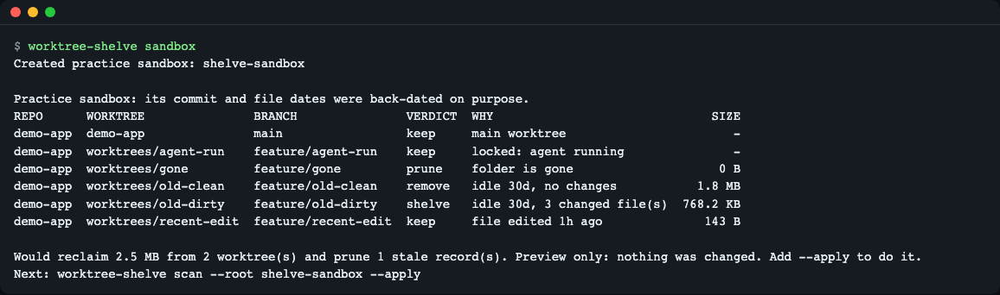
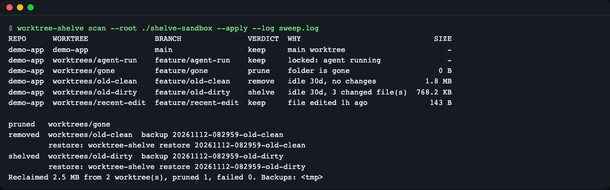
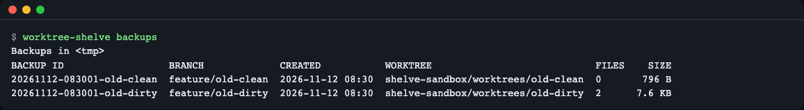
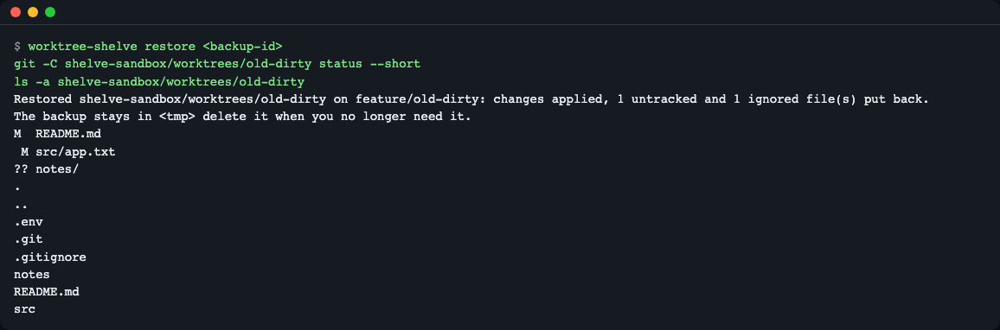
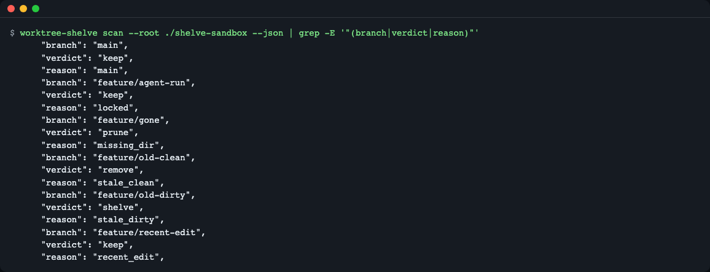
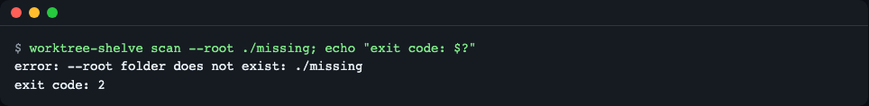
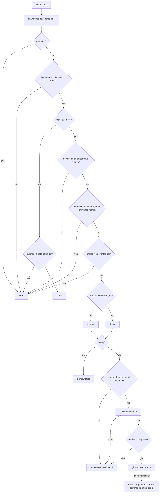

# worktree-shelve

**English** | [한국어](README.ko.md)

Find stale git worktrees, back up everything `git worktree remove` would silently delete, verify the backup, remove the worktree, and restore it later with one command. Nothing is deleted unless you add `--apply`.


*`worktree-shelve sandbox` builds a practice repository and previews it. Two worktrees can be reclaimed, one record is stale, three are kept.*

## Who this is for

- You run several coding agents (or create worktrees by hand) and the disk fills up with forgotten checkouts.
- You want a cleanup that checks both the last commit and the newest file edit, not just the commit date.
- You do not want an automatic cleanup to delete uncommitted work or an ignored `.env` file.

## Why it matters

A git worktree is a second (third, fourth...) checkout of the same repository in its own folder. Each one can hold a full copy of the code plus `node_modules` or other build folders, so a dozen forgotten worktrees can take gigabytes.

Think of a desk where several people leave half-finished work. Throwing away everything older than a week is fast, but someone may lose notes they never filed. worktree-shelve works like a careful office manager: it only clears desks that show no recent activity, puts every loose page in a labeled box first, checks the box, and can put the desk back exactly as it was.

Two facts make this necessary:

- `git worktree remove` refuses a worktree with uncommitted changes, but `--force` deletes them.
- Even without `--force`, it deletes ignored files such as `.env` without warning, because git does not count them as changes.

## Install

Prerequisites: [Dart SDK](https://dart.dev/get-dart) 3.8 or newer (`brew install dart-sdk` on macOS; see the Dart page for Linux) and git 2.36 or newer. On a minimal Linux image you also need `tar` and `curl`/`unzip` for the Dart installer. macOS and Linux are supported, Windows is not (see [Limitations](#limitations)).

```bash
# From GitHub (works once the repository is public)
dart pub global activate --source git https://github.com/LeeGyeongPil/worktree-shelve

# From a clone
git clone https://github.com/LeeGyeongPil/worktree-shelve
cd worktree-shelve
dart pub get
dart run worktree_shelve sandbox

# Optional: one self-contained binary (about 6 MB)
dart compile exe bin/worktree_shelve.dart -o worktree-shelve
./worktree-shelve --version
```

```text
worktree-shelve 0.1.3
```

`dart pub global activate` puts the `worktree-shelve` command in `$HOME/.pub-cache/bin`; add that folder to your `PATH` if the shell does not find it. The commands below assume `worktree-shelve` is on your `PATH` (from a clone, use `dart run worktree_shelve` instead).

## Quick start

Try it on a practice sandbox first. It is a real git repository with five extra worktrees. Its commit and file dates are back-dated on purpose, so it needs no waiting. There is no mock mode: every command below runs real git on the sandbox.

```bash
worktree-shelve sandbox
```

```text
Created practice sandbox: shelve-sandbox

Practice sandbox: its commit and file dates were back-dated on purpose.
REPO      WORKTREE               BRANCH               VERDICT  WHY                              SIZE
demo-app  demo-app               main                 keep     main worktree                       -
demo-app  worktrees/agent-run    feature/agent-run    keep     locked: agent running               -
demo-app  worktrees/gone         feature/gone         prune    folder is gone                    0 B
demo-app  worktrees/old-clean    feature/old-clean    remove   idle 30d, no changes           1.8 MB
demo-app  worktrees/old-dirty    feature/old-dirty    shelve   idle 30d, 3 changed file(s)  768.2 KB
demo-app  worktrees/recent-edit  feature/recent-edit  keep     file edited 1h ago              143 B

Would reclaim 2.5 MB from 2 worktree(s) and prune 1 stale record(s). Preview only: nothing was changed. Add --apply to do it.
Next: worktree-shelve scan --root shelve-sandbox --apply
```

How to read the table:

| Verdict | Meaning |
|---|---|
| `keep` | Left alone. The WHY column says why: main worktree, locked, a recent commit, a recent file edit, and so on. |
| `remove` | Stale and clean. Backed up (ignored config files only), then removed. |
| `shelve` | Stale with uncommitted changes. Everything is backed up, then removed. |
| `prune` | The folder is already gone; only git's leftover record is cleaned up. |

`old-dirty` is stale by commit date and by file dates, so it is `shelve`. `recent-edit` has an old commit but a file edited one hour ago, so it is kept. `agent-run` is locked, so it is never touched.

## Usage

| Command | What it does |
|---|---|
| `worktree-shelve scan --root DIR` | Preview. Finds repositories under `DIR` (default: current folder) and prints one verdict per worktree. Changes nothing. |
| `worktree-shelve scan --root DIR --apply` | Backs up, verifies, then removes `remove`/`shelve` worktrees and prunes gone ones. |
| `--days N` | Stale means last commit AND newest file edit are both older than `N` days (default 7). |
| `--ignored-cap MB` | Keep a worktree whose ignored non-build files exceed `MB` (default 100). |
| `--backup-dir DIR` | Where backups go (see [Configuration](#configuration)). |
| `--json`, `--log FILE` | Machine-readable output; append one JSON line per action to `FILE`. Each line has `action`, `result`, `reason` (code) and `reason_text`. A stale worktree kept because a backup cannot cover it gets an `"action":"skip"` line, so a scheduled run shows why it was not removed. |
| `worktree-shelve backups` | List backups (`--json` also works). |
| `worktree-shelve restore <backup-id> [--to PATH]` | Recreate a removed worktree from its backup. |
| `worktree-shelve sandbox [DIR]` | Create the practice repository and preview it. |

The text examples below keep backups in a local `bk` folder with `--backup-dir bk`, so the same folder is used by `scan`, `backups` and `restore`. The screenshots use the default backup folder instead, so their commands have no `--backup-dir`.

### Apply the cleanup

```bash
worktree-shelve scan --root ./shelve-sandbox --apply --backup-dir bk --log sweep.log
```


*Each removed worktree gets a backup id and a ready-to-paste restore command. `sweep.log` gets one JSON line per action.*

```text
pruned   worktrees/gone
removed  worktrees/old-clean  backup 20261112-073444-old-clean
         restore: worktree-shelve restore 20261112-073444-old-clean --backup-dir /path/to/bk
shelved  worktrees/old-dirty  backup 20261112-073444-old-dirty
         restore: worktree-shelve restore 20261112-073444-old-dirty --backup-dir /path/to/bk
Reclaimed 2.5 MB from 2 worktree(s), pruned 1, failed 0. Backups: /path/to/bk
```

(The table is printed first, as in the preview. Paths are shortened to `/path/to/bk`; the tool prints the full path. `--backup-dir` only appears in the restore command when you passed it.) Branches and commits stay in the repository; only the working folders are removed.

### List and restore

```bash
worktree-shelve backups --backup-dir bk
```


*Backups are plain folders you can open.*

```text
Backups in /path/to/bk:
BACKUP ID                  BRANCH             CREATED           WORKTREE                            FILES    SIZE
20261112-073444-old-clean  feature/old-clean  2026-11-12 07:34  shelve-sandbox/worktrees/old-clean  0       670 B
20261112-073444-old-dirty  feature/old-dirty  2026-11-12 07:34  shelve-sandbox/worktrees/old-dirty  2      7.5 KB
```

```bash
worktree-shelve restore 20261112-073444-old-dirty --backup-dir bk
git -C shelve-sandbox/worktrees/old-dirty status --short
```


*After restore, `git status` is the same as before removal, and the ignored `.env` is back.*

```text
Restored shelve-sandbox/worktrees/old-dirty on feature/old-dirty: changes applied, 1 untracked and 1 ignored file(s) put back.
The backup stays in /path/to/bk/20261112-073444-old-dirty; delete it when you no longer need it.
M  README.md
 M src/app.txt
?? notes/
```

Staged (`M `) and unstaged (` M`) changes come back as they were. Build artifacts such as `node_modules` are not backed up, so reinstall them after a restore.

### Automation

```bash
worktree-shelve scan --root ~/code --days 14 --apply --json --log ~/worktree-shelve.log
```


*`verdict` and `reason` are fixed English codes in every language; `reason_text` follows the chosen language.*

Run it from cron or a scheduler. With many repositories under `--root` the scan calls git many times and can take a while; point `--root` at a narrower folder to speed it up. Exit codes: `0` ok, `1` some worktrees failed, `2` usage or environment error. A failed worktree is left untouched, unless git itself stopped midway while removing it; then the error names the backup id and the restore command (see [Troubleshooting](#troubleshooting)). Errors are one line:


*Errors are one line on stderr, never a stack trace.*

## Safety

- **Preview by default.** Without `--apply`, git is only asked read-only questions. A test checks that the worktree list and the folder listing are identical before and after.
- **Any recent sign of life keeps a worktree.** A recent commit, a recent file edit (a future date counts as recent), a lock, the current folder, a path outside `--root`, a folder containing a mount point, or anything the tool could not inspect: all `keep`. Edits under `node_modules`-style folders, a fresh `.git`, and symlinks pointing outside the repository do not count as activity.
- **What a backup cannot hold is never removed.** A stale worktree is kept, with no backup made, when it has a submodule (`has_submodules`), another git repository inside it such as a cloned folder (`nested_repo`), or an unfinished merge, rebase, cherry-pick, revert or bisect, including files still in conflict (`git_in_progress`). The backup saves patches and files of the worktree itself; it cannot save work inside a submodule or a nested repository, or the state of a half-done merge. This also applies to a worktree whose folder is gone but whose submodule data is still in `.git`.
- **Backup, verify, then remove.** The backup is written to a `.partial` folder, checked (file counts, patch bytes, manifest, and "did the worktree change while we copied?"), and only then renamed and used. Right before removal the submodule / nested repository / unfinished-operation check runs again. If any of this fails, nothing is removed and the exit code is 1.
- **Every folder must be deletable first.** Before backing up, and again right before removing, the tool checks that every folder in the worktree (build folders included) and its parent folder are yours and writable. git does not stop cleanly on a read-only folder: it deletes part of the worktree and drops its record. So if one folder is read-only or owned by another user, nothing is backed up or removed, and the error names that folder (exit 1).
- **If git still stops midway, the backup is kept.** Some cases cannot be seen in advance, such as a locked file (`chflags uchg` on macOS, `chattr +i` on Linux) or a permission change during the run. Then the verified backup is not deleted, and the error and the `FAILED` line give the backup id and `restore <id> --to NEW_PATH`.
- **Even a clean worktree gets a backup.** `git worktree remove` deletes ignored files such as `.env` without a warning, so ignored non-build files are saved too. Dependency, build and cache folders (`node_modules`, `dist`, `build`, `.venv`, `target`, `.dart_tool`, ...) are skipped; if the ignored non-build files add up to more than `--ignored-cap`, the worktree is kept.
- **Commits are pinned.** A detached HEAD commit that no branch or tag contains is saved under `refs/worktree-shelve/<id>` before removal.
- **Locks are respected.** The tool never uses `git worktree remove -f -f`. A single `--force` is used in one place only: removing a `shelve` worktree after its backup passed verification and the re-check. A clean (`remove`) worktree is removed without `--force`, so git refuses if something new appeared.

For example, a 42-day-old worktree `wt` with uncommitted edits inside its submodule `sub`, scanned with `--apply`:

```text
REPO  WORKTREE  BRANCH  VERDICT  WHY                                          SIZE
app   app       main    keep     main worktree                                   -
app   wt        feat    keep     has submodule sub; backups cannot cover it  160 B

Reclaimed 0 B from 0 worktree(s), pruned 0, failed 0. No backup was made.
```

The exit code is 0, no backup is made (an empty `--backup-dir` folder may still be created), and the files inside `sub` are untouched. Other examples of the WHY text: `has another git repo at tools/scratch; backups cannot cover it` and `unfinished git merge; backups cannot cover it`.

A backup folder contains up to five files; the two `.tar` files appear only when there are untracked or ignored files to save. In the sandbox, the `old-clean` backup has three files and the `old-dirty` backup has all five.

| File | Content |
|---|---|
| `manifest.json` | Branch, commit, original path, file lists |
| `changes.patch` | All tracked changes vs `HEAD` (you can also `git apply` it by hand) |
| `staged.patch` | The staged part, so staging is restored exactly |
| `untracked.tar` | Untracked files |
| `ignored.tar` | Ignored non-build files such as `.env` |

## Configuration

| Setting | Meaning |
|---|---|
| `WORKTREE_SHELVE_BACKUP_DIR` | Backup location. Default: `$XDG_STATE_HOME/worktree-shelve/backups`, or `~/.local/state/worktree-shelve/backups`. `--backup-dir` wins. |

### Language

The screen language is English or Korean.

| Setting | Meaning |
|---|---|
| `--lang en\|ko` | Language for this run. |
| `WORKTREE_SHELVE_LANG` | Default language, for example `export WORKTREE_SHELVE_LANG=ko`. |

The first one set wins, in this order: `--lang`, `WORKTREE_SHELVE_LANG`, `LC_ALL`, `LC_MESSAGES`, `LANG`. Anything that does not start with `ko` gives English. Write `--lang` after the subcommand (`worktree-shelve scan --lang ko`), not before it. `--lang ko` switches help, table headers, reasons and errors to Korean; see [README.ko.md](README.ko.md) for screenshots. Error details quoted from git itself (inside parentheses) follow git's own language setting.

## How it works

The rules are checked top to bottom, and the first one that matches wins. The order leans toward keeping.



1. It lists worktrees with git's machine-readable output (`-z`, NUL-separated), so odd paths are handled.
2. Protected means: the main worktree, locked, your current folder, outside `--root`, or a mount point inside.
3. A recent commit keeps it. If the folder is already gone, only git's record is pruned, unless submodule data is still stored in `.git` for it.
4. A recent file edit keeps it; dependency and build folders, `.git` and symlinks are not counted.
5. A submodule, a nested git repository, or an unfinished merge/rebase/cherry-pick/revert/bisect keeps it, because the backup cannot capture them.
6. Too many ignored non-build files keeps it, because the backup would get too large.
7. What is left is `remove` (clean) or `shelve` (has changes). Without `--apply` you only see the table; with `--apply` every folder must be deletable, the backup must pass verification, and step 5 and the folder check run once more, before git removes anything. A failure at any of these points removes nothing.
8. If git itself stops while removing (for example on a locked file), part of the folder may already be gone and git may have dropped its record, so the next scan cannot see it. The verified backup is kept, and the error prints the backup id and the restore command.

## Code tour

Three files hold the core ideas:

| File | What to look at |
|---|---|
| [`lib/src/verdict.dart`](lib/src/verdict.dart) | `_judge`: the rule order above, one `return` per rule. Each `keep` carries a reason code such as `locked` or `recent_edit`. `findBackupBlindSpot` decides `has_submodules`, `nested_repo` and `git_in_progress`; `apply.dart` calls it again right before removal. |
| [`lib/src/activity.dart`](lib/src/activity.dart) | `measureTree`: walks the folder for the newest file edit and the size, skipping dependency/build folders (listed in `artifacts.dart`), the top `.git`, and symlinks. |
| [`lib/src/backup.dart`](lib/src/backup.dart) | `createBackup`: writes `<id>.partial/`, verifies it, then renames it to `<id>/`. [`apply.dart`](lib/src/apply.dart) only calls `git worktree remove` after this succeeds; there, `RemovalCheck.firstBlocker` finds the first folder that cannot be deleted, and the code after `git worktree remove` asks git whether it still lists the worktree, to report a failure truthfully. |

## Terms

| Term | Meaning |
|---|---|
| Worktree | An extra checkout of a repository in its own folder, created with `git worktree add`. It shares the repository's history. |
| Main worktree | The original checkout that holds the `.git` folder. Never removed. |
| Locked worktree | Marked with `git worktree lock` as "in use"; git refuses to remove it without `-f -f`. |
| Prune | Removing git's record of a worktree whose folder no longer exists. |
| Ignored file | A file matched by `.gitignore`, such as `.env`. Git does not track it and does not treat it as a change. |
| Detached HEAD | A worktree on a commit rather than a branch. If no branch or tag contains that commit, it can be lost after removal, so it is pinned. |
| mtime | A file's "last modified" time, used as the "newest file edit" signal. |
| Submodule | A separate git repository pinned inside another one (`git submodule add`). Its own uncommitted work is invisible to the outer repository's `git diff`. |
| Nested repository | Any other folder with its own `.git` inside a worktree, for example something you cloned there by hand. |

## Try it yourself

Each experiment starts from a fresh sandbox (`worktree-shelve sandbox`) and only uses the preview, so nothing is deleted.

1. **Raise the threshold.** Run `worktree-shelve scan --root ./shelve-sandbox --days 60`. Expect every worktree to be `keep`, with `last commit 30d ago` for the sandbox branches, because 30 days is now "recent".
2. **Edit inside `node_modules`, then outside.** Run `touch shelve-sandbox/worktrees/old-clean/node_modules/new.js` and scan again: `old-clean` stays `remove` (dependency folders are not activity). Then run `touch shelve-sandbox/worktrees/old-clean/README.md` and scan: it becomes `keep` with `file edited 0m ago`.
3. **Lock a worktree.** Run `git -C shelve-sandbox/demo-app worktree lock --reason "still mine" ../worktrees/old-dirty` and scan: `old-dirty` becomes `keep` with `locked: still mine`. (Or try `--ignored-cap 0`: it is kept because its `.env` exceeds the cap, shown as `ignored files 51 B over the 0 B cap`.)

## When to use it

- Good fit: many short-lived worktrees (agent runs, review checkouts) on a laptop or build machine, where you want a periodic, reversible cleanup.
- Cleaning dependency or build folders in general: tools such as [npkill](https://github.com/voidcosmos/npkill) or [kondo](https://github.com/tbillington/kondo) are built for that.
- Pruning git's own records only: `git worktree prune` is built in. See the [git docs](https://git-scm.com/docs/git-worktree).

### Related tools

Checked on 2026-11-12 from each project's public page. Details may have changed since, so check the linked pages.

| Tool | What it does | Where it differs from worktree-shelve |
|---|---|---|
| `git worktree prune` / `remove` (built into git) | `prune` clears records of worktrees whose folder is already gone; `remove` deletes one worktree by hand | No age check, no multi-repository sweep, no backup. `remove` on a worktree that has only ignored files deletes them too, `node_modules` included |
| [wtkill](https://github.com/ohernandezdev/wtkill) (Go) | Finds old worktrees across repositories in a TUI or JSON, with `--older-than` and `--dry-run`; refuses dirty ones by default | Judges by last commit age. Backing up uncommitted work is not part of it. Build artifacts are left to npkill |
| [dev-prune](https://github.com/Life-Experimentalist/dev-prune) (Rust) | Deletes `node_modules`, `.venv`, `target` of idle repositories after lockfile checks, with restore commands | Does not cover worktree removal or backup |
| [npkill](https://github.com/voidcosmos/npkill) (TypeScript) | Interactive search and delete of `node_modules` and similar folders | Not git or worktree aware |
| [kondo](https://github.com/tbillington/kondo) (Rust) | Cleans build artifacts of 20+ project types, e.g. `--older 3M` | Not worktree aware, no backup |

When another tool is the better pick:

- You only want to free `node_modules` or `target` folders: use npkill, kondo or dev-prune. worktree-shelve does not clean these folders in worktrees it keeps.
- You want an interactive terminal list of old worktrees and only the last commit age matters: wtkill fits.
- Git's own stale records are the only problem: `git worktree prune`.

What worktree-shelve does today: a two-signal check (commit age and newest file edit), a verified backup before removal (ignored files such as `.env` included, build folders skipped), and a restore command. Cleaning leftovers inside worktrees you keep is planned for M2 (see [Roadmap](#roadmap)).

## Troubleshooting

| Symptom | Cause | Fix |
|---|---|---|
| `error: --root folder does not exist: ...` (exit 2) | The folder you gave is wrong | Check the path; the default is the current folder. |
| A worktree you expected is `keep` | A recent commit or recent file edit, a lock, or it is outside `--root` | Read the WHY column; lower `--days` if you really want it. |
| `keep` with `ignored files ... over the ... cap` (`ignored_too_large` in `--json`) | Ignored non-build files exceed `--ignored-cap` | Raise `--ignored-cap MB` or clean that folder yourself. |
| `error: cannot write to backup folder ...` (exit 2) | The backup folder is not writable | Pass `--backup-dir` with a writable folder. |
| `keep` with `has submodule ...`, `has another git repo at ...` or `unfinished git merge` (`has_submodules`, `nested_repo`, `git_in_progress` in `--json`) | The backup cannot cover work inside a submodule or nested repository, or a half-done git operation | Commit and push the work inside the submodule or nested repository, or finish or abort the merge/rebase (`git merge --abort`, `git rebase --continue`, ...). Then remove the worktree yourself with `git worktree remove` if you still want it gone; the tool keeps worktrees with submodules every time. |
| Exit code 1, `error: <wt>: cannot delete everything: <folder> is read-only or owned by another user (fix it with chmod -R u+w <folder>, or chown if another user created it); left in place, no backup was made. Nothing was removed; run the scan again.` | A folder in the worktree (or its parent) is read-only or belongs to another user, for example one created by a container running as root. git would stop halfway on it, so the tool did not start | Run `chmod -R u+w <folder>`, or `sudo chown -R "$USER" <folder>` if another user created it, then scan again. If the message says `its parent folder` (the blocked folder is the worktree's parent), run `chmod u+w <parent>` or `sudo chown "$USER" <parent>` instead, without `-R`. No backup was made and nothing was deleted. |
| Exit code 1, `error: <wt>: git stopped midway (...); it dropped the worktree record and may have deleted part of the folder. Everything is in backup <id>; restore it with: worktree-shelve restore <id> --to NEW_PATH (or delete <folder> first and run it without --to)` | git could not delete a file it did not expect, such as a locked file (`chflags uchg`, `chattr +i`). It dropped its record and may have deleted part of the folder, so the next scan does not show this worktree | Run `worktree-shelve restore <id> --to <new path>`, or delete the leftover folder and run `worktree-shelve restore <id>`. Restoring to the original place while the leftover folder is there fails with `restore target already exists`. If you lost the id, run `worktree-shelve backups` or look for `backup_id` in the `--log` file. |
| Exit code 1, message `... git still lists the worktree. Backup <id> is kept in case files were deleted; restore with: ... --to NEW_PATH. Fix what git reported, then run the scan again.` | git refused to remove the worktree, for example because a new file appeared in a clean worktree; the reason is in parentheses | Fix what git reported and scan again. If files are missing, run `restore <id> --to <new path>`. Delete the backup when you no longer need it. |
| Exit code 1, message `it changed after the scan (...) ... Nothing was removed; run the scan again.` | A submodule, nested repository or unfinished operation appeared after the scan | Run the scan again; it will now be `keep`. |
| Exit code 1, `backup check failed (...)` or `the worktree changed while it was being backed up` | The backup failed verification | Read the one-line message; nothing was deleted. |
| `error: restore target already exists: ...` (exit 2) | The original folder exists again | Use `restore <id> --to PATH`. |
| `error: branch ... is already checked out in ...` | Another worktree now uses that branch | Remove or switch that worktree first, then restore. |

A real run of the "git stopped midway" case on macOS: a 42-day-old worktree `wt` with an uncommitted edit, an untracked file and one locked file, scanned with `--apply --backup-dir bk --log sweep.log`. Paths are shortened to `/path/to`, and git's own message in parentheses follows git's language setting:

```text
error: wt: git stopped midway (error: failed to delete '/path/to/root/wt': Operation not permitted); it dropped the worktree record and may have deleted part of the folder. Everything is in backup 20261112-082712-wt; restore it with: worktree-shelve restore 20261112-082712-wt --backup-dir /path/to/bk --to NEW_PATH (or delete /path/to/root/wt first and run it without --to)
REPO  WORKTREE  BRANCH  VERDICT  WHY                          SIZE
app   app       main    keep     main worktree                   -
app   wt        feat    shelve   idle 42d, 2 changed file(s)  25 B

FAILED   wt
         restore: worktree-shelve restore 20261112-082712-wt --backup-dir /path/to/bk --to NEW_PATH
Reclaimed 0 B from 0 worktree(s), pruned 0, failed 1. Backups: /path/to/bk
```

After `worktree-shelve restore 20261112-082712-wt --backup-dir bk --to root/wt2`, `git -C root/wt2 status --porcelain` shows ` M z.txt` and `?? new.txt` again, the same as before the run.

## Limitations

- Windows is not supported.
- Worktrees whose main repository is outside `--root` are not found.
- Worktrees that contain submodules are always kept (`has_submodules`), because the backup does not cover work inside submodules. The same goes for nested git repositories (`nested_repo`) and unfinished git operations (`git_in_progress`). The tool never cleans these up; remove them yourself once their work is saved.
- "Newest file edit" relies on file modification times. Copying files with their old times, or restoring from an archive, can make a worktree look older than it is. Use a larger `--days` if your tools do that.
- Dependency and build folders are not cleaned in worktrees that are kept, and are not restored by `restore`.
- The folder check before removal only looks at the owner and the owner's write permission. A folder you can write only through group permission is treated as not deletable, so that worktree fails with exit 1 even though it could be removed. Locked files (`chflags uchg`, `chattr +i`) are not detected in advance; they lead to the "git stopped midway" case in [Troubleshooting](#troubleshooting).
- If standard output is closed early (for example `worktree-shelve sandbox | head -1`), the tool prints a raw `FileSystemException ... Broken pipe` message in English and still exits with code 0. This is not a timing issue: it happens on every run piped into `head`. Redirect to a file instead of piping into `head` if you need a reliable exit code.
- A file name that contains a newline makes the backup check fail for that worktree. The worktree is kept and nothing is deleted, but the `backup check failed (...)` message does not say that the newline is the reason. Rename such files if you want the worktree cleaned up.
- When the tests run as root (for example in a root container), the two "git stops midway" tests return early and are reported as passed, not as skipped, because root ignores the read-only folder they rely on. Run `dart test` as a normal user to really exercise them.
- A folder under `--root` with an incomplete `.git` folder (no `HEAD`) that sits inside another git repository can be resolved by git to that enclosing repository. The table then shows a misleading `keep  main worktree` row whose path is outside `--root`. Nothing is removed in that case.

## Roadmap

- **M2 (planned):** clean leftovers inside worktrees you keep: test reports and caches that are safe to delete when old, and dependency or build folders only when the whole repository is idle; stale `tmp_pack_*` files in `.git`; a hint for the reinstall command.
- **M3 (planned):** prebuilt binaries for macOS arm64 and Linux x64, `backups --prune-older-than N`, `--include-outside-root`, pub.dev publish preparation (metadata and `dart pub publish --dry-run`).

## Learn more

- [git-worktree documentation](https://git-scm.com/docs/git-worktree): `add`, `remove`, `prune`, `lock`, and the `--porcelain -z` output format (checked 2026-11-12).
- [gitignore documentation](https://git-scm.com/docs/gitignore): which files count as ignored.
- [Dart: compile to a native executable](https://dart.dev/tools/dart-compile): how the single binary is built.

## Development

```bash
dart pub get
dart analyze --fatal-infos
dart test
```

The tests create real throwaway git repositories under the system temp folder and never touch yours. Bugs and ideas are welcome as issues. Changes are listed in [CHANGELOG.md](CHANGELOG.md). Security reports: see [SECURITY.md](SECURITY.md).

## License

MIT. No runtime dependencies; development uses `test` and `lints`.
